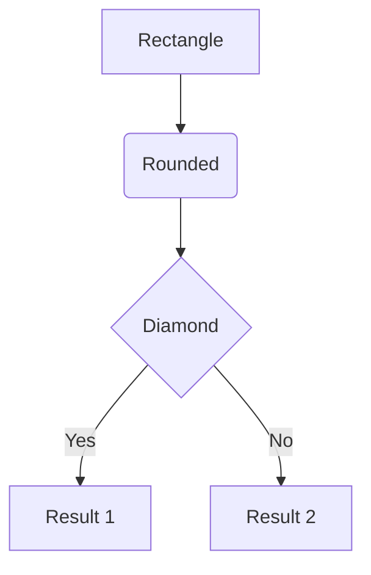
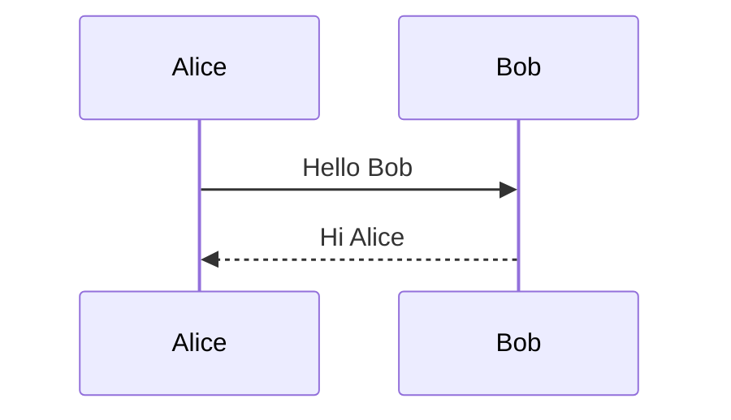

# mermaid2term

Render [Mermaid](https://mermaid.js.org/) diagrams as ASCII/Unicode art in the terminal.

```
┌───────┐
│       │
│ Start │
│       │
└───────┘
    │
    │
    │
┌───▼────┐
│        │
│ Process│
│        │
└────────┘
    │
    │ Yes
    ├────────────┐No
    │            │
┌───▼───┐   ┌────▼───┐
│       │   │        │
│  Done │   │  Skip  │
│       │   │        │
└───────┘   └────────┘
```

## Installation

```bash
npm install -g mermaid2term
```

Or use directly with npx:

```bash
npx mermaid2term diagram.mmd
```

## Usage

### CLI

```bash
# From a file
mermaid2term diagram.mmd

# From stdin
echo 'graph LR; A-->B; B-->C' | mermaid2term

# With options
mermaid2term --charset ascii diagram.mmd
```

### Options

| Option | Description | Default |
|--------|-------------|---------|
| `-c, --charset <type>` | Character set: `unicode` or `ascii` | `unicode` |
| `-h, --help` | Show help | |
| `-V, --version` | Show version | |

### Programmatic API

```typescript
import { render } from 'mermaid2term';

const diagram = `
graph TD
    A[Start] --> B{Decision}
    B -->|Yes| C[Do Something]
    B -->|No| D[Skip]
    C --> E[End]
    D --> E
`;

const output = render(diagram);
console.log(output);
```

#### API Reference

##### `render(input: string, options?: RenderOptions): string`

Renders a Mermaid diagram to ASCII/Unicode art.

**Parameters:**
- `input` - Mermaid diagram source
- `options` - Optional configuration object

**Options:**
```typescript
interface RenderOptions {
  charset?: 'unicode' | 'ascii';  // Default: 'unicode'
  paddingX?: number;              // Horizontal padding between nodes (default: 4)
  paddingY?: number;              // Vertical padding between nodes (default: 2)
  borderPadding?: number;         // Padding inside node borders (default: 1)
}
```

## Supported Diagram Types

### Flowcharts

Full support for flowchart/graph diagrams:



**Supported features:**
- Directions: `TD`/`TB` (top-down), `LR` (left-right), `RL` (right-left), `BT` (bottom-top)
- Node shapes: rectangles `[]`, rounded `()`, diamonds `{}`
- Edge types: solid `-->`, dotted `-..->`, thick `==>`
- Edge labels: `-->|label|`
- Cycles/back-edges (rendered with proper routing)
- Semicolon syntax for single-line diagrams

**Example:**

```bash
echo 'graph LR; A-->B; B-->C; C-->A' | mermaid2term
```

Output:
```
┌───┐     ┌───┐     ┌───┐
│   │     │   │     │   │
│ A │─────► B │─────► C │
│   │     │   │     │   │
└─▲─┘     └───┘     └───┘
  │                   │
  └───────────────────┘
```

### Sequence Diagrams

Basic support for sequence diagrams:



## Character Sets

### Unicode (default)

Uses Unicode box-drawing characters for crisp rendering:
```
┌───────┐
│ Node  │
└───────┘
    │
    ▼
```

### ASCII

For terminals without Unicode support:
```
+-------+
| Node  |
+-------+
    |
    v
```

## Examples

### Decision Flow

```bash
echo 'graph TD
    Start --> Process
    Process --> Decision{Valid?}
    Decision -->|Yes| Success
    Decision -->|No| Error
    Error --> Process
    Success --> End' | mermaid2term
```

### Horizontal Flow

```bash
echo 'graph LR
    Input --> Process
    Process --> Output' | mermaid2term
```

### With Labels

```bash
echo 'graph TD
    A -->|step 1| B
    B -->|step 2| C
    C -->|step 3| D' | mermaid2term
```

## Development

```bash
# Clone the repository
git clone https://github.com/watzon/mermaid2term.git
cd mermaid2term

# Install dependencies
npm install

# Build
npm run build

# Run tests
npm test

# Development mode (watch)
npm run dev
```

## License

MIT
